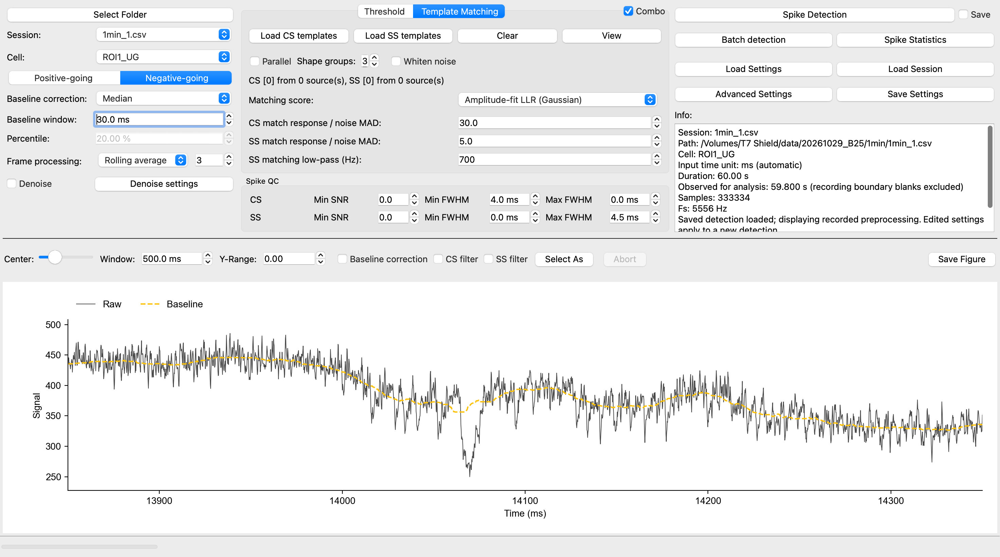
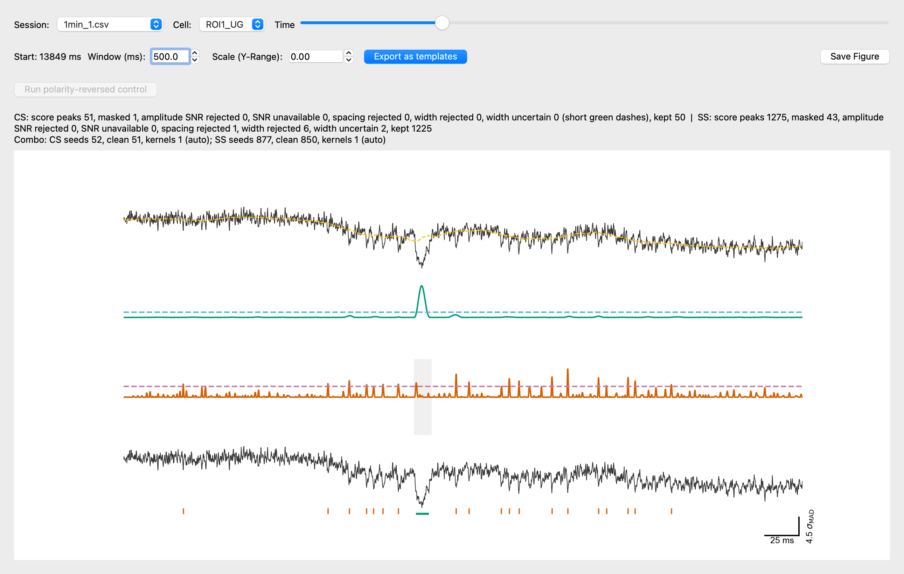
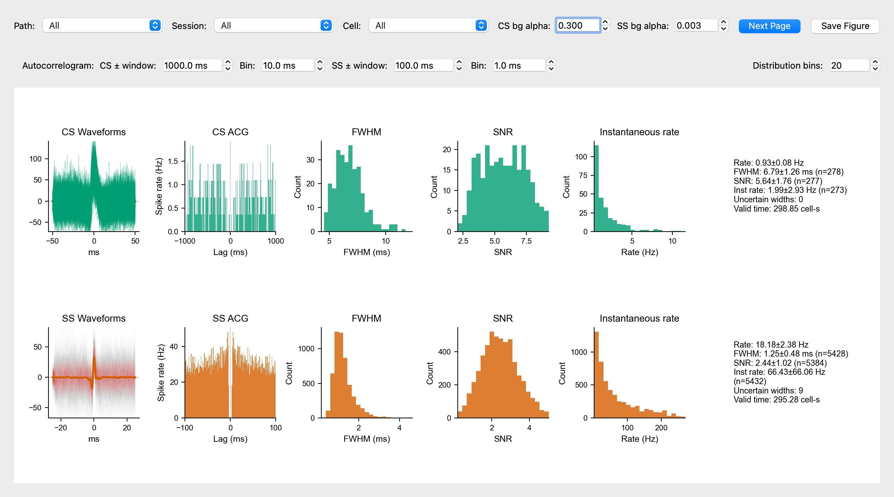
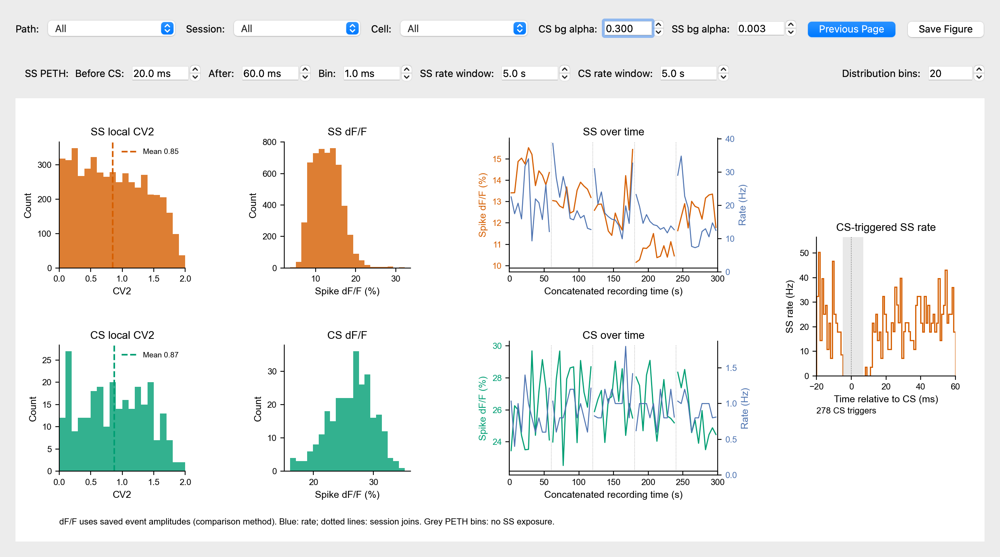

# Spike Detector GUI

Detect complex spikes (CS) and simple spikes (SS) in voltage-imaging recordings of cerebellar Purkinje neurons. The desktop GUI supports threshold detection, template matching, cell-specific automatic templates, manual labels, batch processing and spike statistics.

## Install And Run

Download the [latest release](https://github.com/Qiyuan-Liang/Spike_detector/releases/latest) for the packaged macOS ARM64 app or Windows build bundle. The Windows ZIP contains source and a one-click builder, rather than a prebuilt EXE. Locally built macOS apps are not Apple-notarized.

To run from source, use Python 3.10 or newer:

```bash
conda create -n spike_detector python=3.11 -y
conda activate spike_detector
pip install -e .
python -m spike_detector
```

Alternatively, use `uv venv --python 3.11`, activate the environment, then `uv pip install -r requirements.txt`. See [UV.md](UV.md) for setup details. Launch with `python -m spike_detector` or `spike-detector`; direct execution of `gui.py` does not support package imports.

## Key Workflow

1. **Select Folder** and choose a recording folder. Select a **Session** and **Cell**, then set **Positive-going** or **Negative-going** to match the indicator.
2. Choose baseline correction and frame processing. **Rolling average** smooths adjacent frames; **Mean** averages non-overlapping frame groups and interpolates onto the original time grid. Optional **Denoise** has a separate settings dialog. Review the raw trace before detection.
3. Select **Threshold**, **Template Matching**, or enable **Combo**. Set the shared **Spike QC** limits for CS and SS. Hover over any setting for its meaning; zero disables the indicated filter or QC limit.
4. Click **Spike Detection**, then inspect **Detection Viewer** and **Spike Statistics**. **Batch detection** applies the same configuration to multiple selected folders.
5. Leave **Save** unchecked for temporary viewing, or check it to retain results. **Save Settings** stores a reusable configuration; **Load Settings** restores it. **Load Session** opens previous results without running detection again.

### Example: Five One-Minute Recordings

The screenshots use `/Volumes/T7 Shield/data/20261029_B25/1min`: five 60-second recordings, each with one ROI at approximately 5.56 kHz. The source recordings are not included in the repository. The main and detection screenshots show the same clear CS/SS train in `1min_1.csv`, around 14.1 seconds (500-ms view).

The [example settings](docs/gui/example-settings.json) use Negative-going polarity, Median baseline correction (30 ms), Rolling average (3 frames), and Combo. Seeds are CS 6.0 and SS 3.0; final amplitude-fit matching cutoffs are CS 30.0 and SS 5.0. SS matching low-pass is 700 Hz; Parallel and Whiten noise are off. QC uses CS minimum FWHM 4.0 ms and SS maximum FWHM 4.5 ms. This is an illustrative preset, not a validated accuracy benchmark.



In Detection Viewer, the tracks show raw/baseline, CS score, SS score, and raw with accepted event markers. SS ticks and green CS duration bars follow the indicator polarity: above positive-going traces and below negative-going traces. Rejection counts explain why an above-cutoff candidate may be absent from the accepted events. Recording exclusions are shaded. A short green dash marks a retained CS whose width could not be measured; it does not represent a measured FWHM.



Use **Run polarity-reversed control** to inspect matches in the opposite direction. The control is diagnostic, not a calibrated false-positive estimate; it may be unavailable for archived results lacking the required context. **Export as templates** saves detected waveforms, and **Save Figure** exports the current view.

## Detection And Defaults

**Threshold** detects peaks in the separately filtered CS and SS traces using a robust MAD-based noise estimate. CS events are detected and quality-checked first; accepted CS define the SS exclusion windows. SS detection then applies its own cutoff, spacing and shared QC. Set a type's threshold to zero to disable it; exports retain both types with empty arrays for the disabled one.

**Template Matching** compares moving trace windows with loaded CS/SS template banks. **Amplitude-fit LLR (Gaussian)** fits template amplitude under a Gaussian noise model. Its GUI cutoff is matched response divided by the estimated noise scale, not a posterior spike probability or calibrated significance level. **Normalized Similarity** compares waveform shape. **Positive-core LLR (experimental)** changes SS matching to positive weights in a central 3-ms template core; it discards negative template lobes and therefore some waveform information. Check this experimental option against independent labels.

**Combo** runs threshold seeds → temporary templates → template matching. It learns aligned, normalized templates separately for each cell/session, requiring at least three clean seeds per type. The Threshold tab controls seed selection; Template Matching controls the final pass, which can recover events below the seed cutoff. If seeds are insufficient, a loaded bank supplies the fallback; otherwise that type has no available template. Zero seed threshold disables seed collection for that type, but an available loaded bank can still detect it.

**Parallel** groups template shapes and scores the enabled groups; **View** shows their membership and selection. Advanced Settings controls PCA components. More groups can recover varied shapes but also offer more opportunities for false matches. **Whiten noise** estimates background temporal correlations and applies the same noise transformation to data and templates. It is available for template matching, Combo and batch detection. Compare results with and without it using held-out labels.

Fresh/reset defaults include:

| Setting | Default |
| --- | --- |
| Baseline correction | Median, 30 ms |
| Polarity | Negative-going |
| CS filter | Low-pass 150 Hz; high-pass off |
| SS filter | Off |
| Threshold / Combo seeds | CS 6.0, SS 3.0 |
| Template response/noise cutoff | CS 30.0, SS 5.0 |
| SS minimum spacing | 3 ms |
| SS exclusion around CS | 4 ms before, 6 ms after |
| Shared width QC | CS minimum 4.0 ms; SS maximum 4.5 ms |
| Recording blanks | Initial 150 ms; final 50 ms |
| Viewer window | 1000 ms |

Change spacing and CS-related SS exclusions in **Advanced Settings**. Template windows touching excluded samples are also rejected, so their effective excluded region can extend beyond the requested interval. Existing saved settings remain authoritative until changed or reset.

**Spike QC** applies amplitude SNR and minimum/maximum FWHM limits in all detection modes. Unmeasurable widths remain marked uncertain and are retained; finite widths outside enabled limits are rejected. FWHM summaries omit uncertain widths. Detection cutoffs, amplitude SNR, and waveform width are different measurements: tune them separately. Validate sensitivity and false positives with independent manual labels across quiet periods, bursts and cells; attractive waveforms or larger event counts alone do not establish accuracy.

## Statistics

Choose **Path → Session → Cell** to pool the desired records. Pooling never forms spike pairs across different cells or sessions. **Distribution bins** controls histogram resolution; all statistics controls are saved with the configuration.

Page 1 shows CS and SS waveforms, ACG, FWHM, amplitude SNR, instantaneous rate and summaries. ACGs show conditional spike rate in Hz, with recording-edge and observation-mask exposure correction and self-pairs excluded. Their half-window/bin defaults are CS 1000/10 ms and SS 100/1 ms.



Click **Next Page** for SS above CS, each with local CV2, spike dF/F and paired amplitude/rate time courses. The CS-triggered SS-rate plot sits at right. Page-specific controls replace ACG settings with PETH range/bin size and separate SS/CS time-course windows.



- **CV2:** `2 × |ISI₂ − ISI₁| / (ISI₂ + ISI₁)`, computed from consecutive intervals within uninterrupted observed segments. It never bridges masks or recordings.
- **dF/F:** saved per-event amplitudes take precedence, including unavailable values. Missing measurements use the `Analysis/compare.ipynb` fallback: a 30-ms event window and central approximately ±5-ms extremum search. Values are polarity-aligned percentages: `s × 100 × (Fpeak − F0) / |F0|`, where `s` is −1 for negative-going and +1 for positive-going. Invalid baseline or unavailable amplitude remains missing, rather than zero.
- **Time courses:** sessions concatenate in numerical filename order within one Path, retaining full acquisition durations and marking joins. Unknown between-session gaps are not invented. Five-second non-overlapping bins show mean finite dF/F and event count divided by observed cell-time, with separate SS/CS window settings. Missing cells preserve empty time slots; lines never bridge sessions. Multiple batch Paths leave time courses blank until one Path is selected. These are descriptive amplitude/rate trends, not a fitted bleaching model.
- **CS-triggered SS rate:** defaults to −20 through +60 ms with 1-ms bins. Counts are divided by observable SS exposure within each cell/session before pooling. Grey bins have no exposure; they do not demonstrate a biological pause.

**Save Figure** exports the visible page. SVG and PDF preserve editable Arial text; PNG screenshots are raster images. An [editable example SVG](docs/gui/statistics-details.svg) is included.

## Files, Settings And Manual Labels

Inputs are CSV/XLSX tables with time in the first column and cells in subsequent columns, or supported saved NPZ recordings. Time units are inferred and reported. Auxiliary coordinate/time-offset tables, Excel lock files and malformed recordings are skipped. Invalid timestamps, nonfinite traces or filter bands above Nyquist require correction before detection.

Initial/final blanks are excluded before preprocessing, noise estimation, detection and statistics. Rolling averages smooth blanked segments separately for display, without letting their artifacts enter the observed trace. New views start after the initial blank. Raw acquisition samples remain archived, so downstream analysis must respect `analysis_valid_mask`.

With **Save** enabled, each recording's `spike_detection/` folder receives `SESSION_analyzed.npz` and a matching settings JSON. Existing results require confirmation before replacement; source recordings are preserved. Exports contain traces, events, masks, per-event measurements and run settings. Without Save, temporary results remain viewable until closing and abandoned temporary files are cleaned on relaunch.

**Load Session** restores archived traces, events and run settings; switching sessions follows their saved configuration. Changing controls prepares a new run and does not alter archived detections. **Load Settings** changes configuration without loading events. Saved template paths must remain accessible when moving configurations between computers. Reset is inside Advanced Settings.

For manual work, click **Select As** and choose **CS template**, **SS template** or **Spike label**. Template selection collects waveform examples. Spike label mode starts empty or reopens existing manual labels: left-click adds SS, Control+left-click adds CS, and right-click removes the nearest selection. Selections remain associated with their original cell/session as you navigate. **Save Labels** writes `SESSION_labels.npz` in the detection-result format and makes the labels available to Statistics. Labels are marked partial; an unlabelled time is not automatically a confirmed negative.

## Build And Help

Build the Windows source bundle with `python scripts/create_windows_bundle.py`; extract it on Windows and run `build_windows_uv.bat`. Keep the complete output application folder. See [WINDOWS_BUILD.md](WINDOWS_BUILD.md).

For macOS, install packaging dependencies with `uv sync --python 3.11 --extra packaging`, then run `.venv/bin/python -m PyInstaller --noconfirm --clean packaging/pyinstaller/spike_detector.spec`. The app appears in `dist/Spike Detector.app`. Build on the target platform.

If a recording is skipped, read the GUI message for the failed format/filter check. If SS detections disappear near CS, inspect the exclusion windows and template support. If detection looks inconsistent, check polarity, preprocessing, amplitude QC and uncertain widths before lowering cutoffs. Hover help describes individual controls. The raw-view scale bar uses the SD-equivalent robust noise estimate `σMAD = 1.4826 × median(|x − median(x)|)`, rather than unscaled MAD.
